<a href="#about"></a><a href="#skills"></a><a href="#connect"></a>

<picture>
  <source media="(max-width: 600px)" srcset="assets/hero-mobile.svg" />
  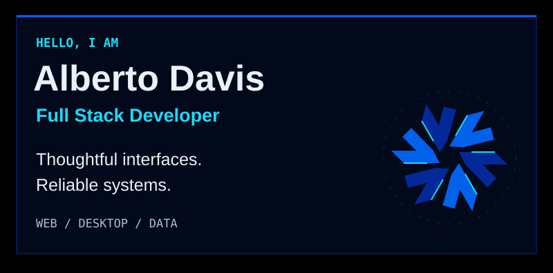
</picture>

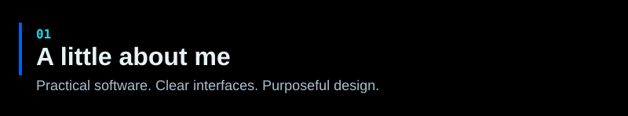

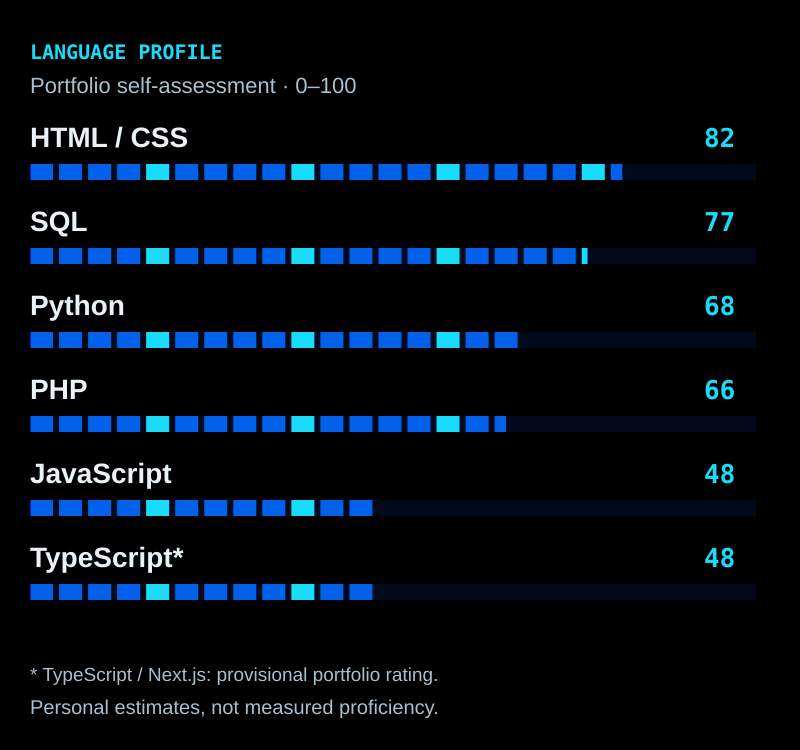


<a href="https://themis.zenreverse.space"></a>

<a href="https://sentinel.zenreverse.space"></a>

<a href="https://rochy.zenreverse.space"></a>

<a href="https://github.com/amberlight123/Sabores-del-Mar"></a>

<a href="https://github.com/amberlight123/vozelia_site_personal_project"></a>



Text version & project links

Alberto Davis — Full Stack Developer. I build web and desktop applications, from the database to the interface. My interests include networking, interface design and cybersecurity fundamentals.

Languages: HTML/CSS, SQL, Python, PHP, JavaScript and TypeScript.

Tools: Figma, Claude, Claude Code, React, Next.js, Node.js, Vite, FastAPI, PySide6, Npcap, Inno Setup, MySQL, PostgreSQL, Apache, Azure and Vercel.

Additional capabilities: Linux, TCP/IP, routing, switching, network automation, security fundamentals, UI/UX design, applied AI with Python, Scrum, data analysis and technical presentations.

Capability profile (portfolio personal ratings / 100): Applied AI 68, UI/UX design 65, networking 60, cybersecurity 60, Scrum 56, Linux 43, Node.js 37.

- [Themis](https://themis.zenreverse.space): CSV analysis and unusual-record detection. Next.js, TypeScript, FastAPI, PostgreSQL and Azure.
- [Sentinel](https://sentinel.zenreverse.space): Desktop network discovery and open-port auditing. Python, PySide6 and Npcap.
- [Rochy Spa Center](https://rochy.zenreverse.space): Online bookings and appointment management. JavaScript, Node.js and PostgreSQL.
- [Sabores del Mar](https://github.com/amberlight123/Sabores-del-Mar): Restaurant menus, orders and reservations. PHP, MySQL and HTML/CSS.
- [Vozelia](https://github.com/amberlight123/vozelia_site_personal_project): Personal VoIP operations project, independent of its reference company. PHP, MySQL, JavaScript and Apache.

[Portfolio & contact](https://albdavis.zenreverse.space/#contact) · [LinkedIn](https://www.linkedin.com/in/alberto1davis) · [GitHub](https://github.com/amberlight123)

[Design, chart sources and maintenance](assets/theme.md)

